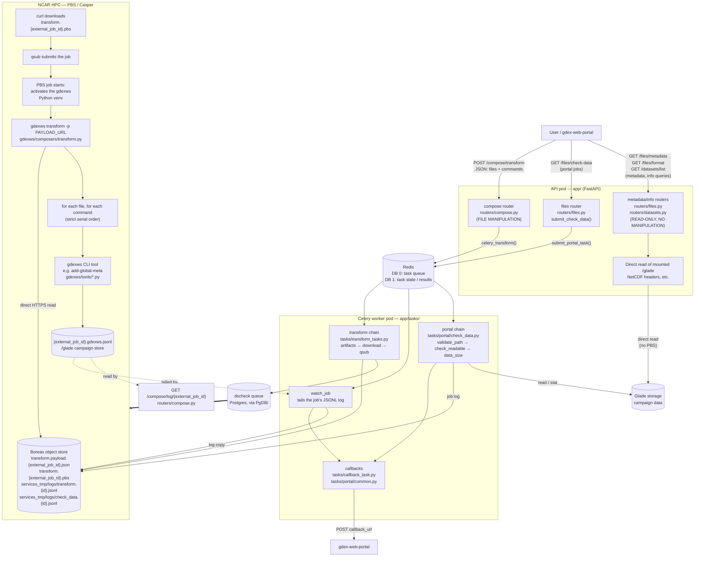

# Architecture

This document describes how requests flow through `gdex-web-services`, and how the two Python packages in this repo — the API server and its Celery worker (`app/`), and the HPC execution package (`gdexws/`) — are each organized by separation of concern.

See the [main README](README.md) for install/run/deploy instructions.

## 1. End-to-end workflows

The API runs as two Kubernetes Deployments built from the same image: the **API pod** (FastAPI) and the **Celery worker pod**, joined by **Redis** (DB 0 is the task queue, DB 1 holds task state and results; see `app/celery_app.py`). Both pods mount `/glade`. Endpoints that take more than a moment queue Celery tasks and return an id right away; the worker does the work and, if the caller gave a callback URL, POSTs the result back to the gdex-web-portal.

There are three kinds of request:

- **Transform jobs** (`POST /compose/transform`, §1.1): change data files. The worker hands the job to NCAR HPC through `dscheck`; the curation itself runs on HPC, never in a pod.
- **Portal jobs** (e.g. `GET /files/check-data`, §1.2): read-only checks for the portal that take too long for a request, run as a chain of steps in the worker pod.
- **Read-only queries** (`GET /files/metadata`, `/files/format`, `/datasets/list`, ...): answered directly in the API pod from `/glade`, with no Celery.



### 1.1 Transform jobs

A curation task (e.g. "add a global attribute to this NetCDF file") crosses four execution boundaries: the API pod, the Celery worker pod, the GDEX job queue (`dscheck` / Postgres), and NCAR HPC (PBS/Casper). Neither pod touches the data files — the worker only builds a payload + PBS script and hands execution to HPC via `dscheck`.

1. **User submits a curation task** as a single JSON request — a list of relative `Files`, a list of `Commands` (each a `command` name and its parameters), and an optional `CallbackUrl` — validated against the `TransformRequest` schema.
2. **API pod accepts the request** at `POST /compose/transform`: it rejects file paths that escape the exchange directory and callback URLs not in `ALLOWED_CALLBACK_URLS` (`app/utils/callback.py`), generates an `external_job_id` (UUID) used to name every artifact for this job, and calls `celery_transform`, which queues the work and returns. The response carries `external_job_id`, `status_url` and `log_url`.
3. **Worker builds and dispatches the job** as a chain of Celery tasks (`app/tasks/transform_tasks.py`), each run under task id `{external_job_id}:{step}`:
   - `artifacts` (`create_boreas_artifacts`): serializes the request to a JSON payload, templates a PBS script around it, and uploads both to the Boreas object store (S3-compatible), keyed by `external_job_id`, so the HPC side only ever needs a URL.
   - `download` (`add_dscheck_download`): inserts the `dscheck` row (via `rda_python_common`) that has HPC `curl` the PBS script.
   - `qsub` (`add_dscheck_qsub`): re-queues itself until the downloaded script exists on `/glade` (avoiding a race), then inserts the `qsub` row.
   Each step retries on its own and is safe to redeliver. If a step fails for good, `chain_failed` marks the request FAILURE and sends the callback.
4. **HPC executes the job**: once `dscheck` runs the queued `qsub`, PBS starts the job, which activates the `gdexws` virtualenv already installed on HPC and runs `gdexws transform -p <payload_url>`, reading the payload directly from its Boreas URL — no shared filesystem hand-off is needed between the pods and HPC.
5. **`transform` runs the payload serially**: for each file, for each command (in the order given), it shells out to the corresponding `gdexws` CLI tool. Any non-zero exit aborts the job. Every step — including PBS shell start/end markers — is appended as one JSON line to `{external_job_id}.gdexws.jsonl` on the shared `/glade` campaign store.
6. **Worker tracks the job and reports back**: `watch_job`, started alongside the chain under task id `external_job_id`, re-schedules itself on each poll until the job ends. Each poll it:
   - checks that the job's `qsub` row still exists in `dscheck`; a missing row means the PBS job is gone (e.g. cancelled), which is reported as `PBS_FAILURE_REPORTED`;
   - tails that JSONL file and mirrors the latest line into its Celery state (`PBS_PROGRESS`, or `PBS_FAILURE_REPORTED` for an `ERROR` line);
   - re-uploads the whole log to Boreas at `services_tmp/logs/transform.<external_job_id>.jsonl` when there are new lines (best effort; an upload failure doesn't fail the job).
   On a terminal line it sets `SUCCESS` (job completed) or `PBS_FAILURE_REPORTED` (job failed); `FAILURE` is kept for a broken worker or chain step. Then, if a callback URL was given, `notify_callback` POSTs the final result to the portal (with retries; its outcome is recorded under `{external_job_id}:callback-final`).

Status endpoints: `GET /compose/status/{external_job_id}` reads the Celery state (job progress, each chain step, the callback); `GET /compose/log/{external_job_id}` returns the full JSONL log from `/glade`; `GET /compose/status/{cindex}` reports a single `dscheck` record.

### 1.2 Portal jobs

Portal jobs are read-only checks the gdex-web-portal runs on `/glade` data that are too slow to answer within a request. They run entirely in the worker pod — no `dscheck` or HPC. `GET /files/check-data` is the first one; `GET /celery/test-celery` is a one-task smoke test. The package overview in `app/tasks/portal/__init__.py` explains how to add one.

1. **API pod queues the job**: the endpoint calls its submit function (e.g. `submit_check_data`), which builds a chain of Celery tasks, one per step, and returns `{"external_job_id": "<id>", "status": "SUBMITTED", "result": null}`. The chain is queued only after that response is sent.
2. **Worker runs the steps in order** (for check-data: `validate_path → check_readable → data_size`), passing one *step report* from task to task. Each step records its own entry: `SUCCESS` (it ran; its `result` may still be `false`), `FAILURE` (it raised; the message is in `error`), or `SKIPPED`. A step runs only if every earlier step succeeded with `result: true`. Steps record errors instead of raising, so the chain always finishes with a complete report.
3. **Worker saves the log**: each step adds lines in the same JSONL format as transform jobs, and the last step uploads them to Boreas at `services_tmp/logs/<endpoint>.<external_job_id>.jsonl` and sets the report's `log_url`. Nothing is written to `/glade`.
4. **Result is delivered**: if a `callback_url` was given, the report is POSTed to it. It can also be fetched from `GET /celery/task-status/<external_job_id>`. Either way the envelope is `{"external_job_id", "status", "result"}`. `status` is `FAILURE` if any step failed, or if the job crashed outside a step (then `result` is the error message). Otherwise it is `SUCCESS`, **even if a step returned `false`** (e.g. some files are unreadable), so callers must read each step's `result`.

The shared machinery (response format, submitting, callbacks, step reports) is in `app/tasks/portal/common.py`.

## 2. API server and worker (`app/`)

A FastAPI application plus the Celery tasks its worker runs. Neither runs a curation command itself: the API pod handles HTTP and queues work, and the worker dispatches transforms to HPC and runs portal jobs. It is organized as thin transport, isolated schemas, Celery tasks, and single-purpose integration utilities:

```
app/
├── main.py                 # FastAPI app assembly — wires routers together
├── celery_app.py           # Celery app: Redis broker/backend URLs and worker settings
├── routers/                # HTTP layer: request/response only, no business logic
│   ├── compose.py          #   POST /compose/transform, GET /compose/status, /log, /health
│   ├── celery.py           #   GET /celery/task-status/{id} (portal jobs), /celery/test-celery
│   ├── datasets.py         #   dataset listing/metadata endpoints
│   ├── files.py            #   file format sniffing, metadata preview, access checks, /check-data
│   └── generators.py       #   NetCDF variable plot -> PNG, uploaded to object store
├── schemas/
│   └── models.py           #   Pydantic models (TransformRequest, Command) + input validation
├── tasks/                  # Celery tasks, run in the worker pod
│   ├── transform_tasks.py  #   transform chain (Boreas upload, dscheck inserts) + watch_job
│   ├── callback_task.py    #   notify_callback: transform result -> portal, with retries
│   └── portal/             #   portal jobs (see its __init__.py)
│       ├── common.py       #     response format, submitting, callbacks, step reports
│       ├── check_data.py   #     GET /files/check-data: validate_path -> check_readable -> data_size
│       └── smoke.py        #     GET /celery/test-celery
└── utils/                  # integration/business logic, one concern per module
    ├── boreas.py           #   boto3 S3 client factory for the Boreas object store
    ├── payload.py          #   builds + uploads the transform JSON payload
    ├── pbs.py              #   templates + uploads the PBS job script
    ├── callback.py         #   POSTs a result to the portal with the shared secret
    ├── job_log.py          #   job logs: JSONL log_format + upload to Boreas (transform and portal)
    ├── dscheck_json.py     #   reads dscheck records + tails job JSONL logs into a standard response shape
    └── file_validation.py  #   relative-path containment check (defense against path traversal)
```

**Separation of concerns:**

| Layer | Responsibility | Depends on |
|---|---|---|
| `routers/` | Parse HTTP requests, call a submit function or `utils/`, shape HTTP responses. Routers that start jobs know only the submit function (`celery_transform`, `submit_check_data`), not the steps or Celery chains behind it. | `schemas/`, `utils/`, `tasks/` (submit functions only) |
| `schemas/` | Define and validate the wire format (`TransformRequest`/`Command`). Rejects absolute paths and `..` traversal before any handler logic runs. | — |
| `tasks/` | The work that runs in the worker: building chains, retries, tracking job state in Redis, and callbacks. `transform_tasks.py` is the only place that writes to `dscheck`. | `schemas/`, `utils/` |
| `utils/` | Each module owns exactly one external integration: Boreas/S3 (`boreas.py`), payload construction (`payload.py`), PBS script construction (`pbs.py`), the portal callback (`callback.py`), job logs on Boreas (`job_log.py`), or `dscheck`/log status (`dscheck_json.py`). | `schemas/` (payload only) |

Writing to `dscheck` (via `rda_python_common`'s `PgDBI`/`PgLOG`) lives in `tasks/transform_tasks.py`, not in `utils/`: deciding *when* to enqueue each step is a job-orchestration concern, while `utils/` only knows how to *build* the artifacts a job needs. `routers/compose.py` only reads `dscheck`, for `GET /compose/status/{cindex}`.

Most of `routers/files.py`, plus `routers/datasets.py` and `routers/generators.py`, are self-contained, read-only conveniences (format sniffing, metadata, plotting) that run entirely in the API pod. The exception is `GET /files/check-data`, which queues a portal job (§1.2).

## 3. HPC execution package (`gdexws/`)

Installed as a Python package directly on HPC (`pip install .`) and executed there by the PBS job. It is organized as one orchestrator, many single-purpose tools, and shared low-level helpers:

```
gdexws/
├── composers/
│   └── transform.py        # orchestrator: loads the payload, drives the serial file x command loop
├── tools/
│   └── add_global_meta.py  # one curation operation per module; each is its own CLI
├── utils/
│   ├── parse_payload.py    #   load_payload (file/URL), build_command, execute_command (subprocess)
│   ├── file_validation.py  #   relative-path containment check (re-validated at execution time)
│   └── logging.py          #   service_log / log_format — the JSONL structured-log format
├── pbs/
│   └── transform.pbs       # reference PBS script template (superseded per-job by utils/pbs.py's generated version)
└── pyproject.toml          # registers the single `gdexws` CLI entry point
```

**Separation of concerns:**

| Layer | Responsibility | Depends on |
|---|---|---|
| `composers/` | Orchestration only: read `Files`/`Commands` from the payload, translate each command dict into a CLI invocation, run them in order, stop on first failure. Knows nothing about *what* any individual command does. | `utils/` |
| `tools/` | One curation operation per module (e.g. `add_global_meta.py`), each with its own `argparse` CLI and its own entry point in `pyproject.toml`. Adding a new curation capability means adding a new file here, not touching the composer. | `utils/` |
| `utils/` | Shared, low-level helpers with no orchestration or curation logic of their own: payload loading (`parse_payload.py`), path safety (`file_validation.py`), and the structured JSONL log format (`logging.py`) every command/composer writes through. | — |

`composers/transform.py` never imports a tool module directly — it calls tools the same way a human would, as subprocesses via `build_command`/`execute_command`, using `gdexws <tool>` subcommands, which `gdexws/cli.py` auto-discovers from `tools/` and `composers/`. This keeps the composer decoupled from any given tool's Python API and means the payload's `"command": "add_global_meta"` maps 1:1 onto a `gdexws` subcommand (`gdexws add-global-meta`), not a Python import path.

## 4. Cross-cutting notes

- **Path validation is duplicated on purpose.** `app/utils/file_validation.py` (API server) and `gdexws/utils/file_validation.py` (HPC) implement the same relative-path containment check independently, in two different processes/environments. The API layer validates early (fail fast, before any HPC resources are spent); `gdexws` re-validates at execution time because it is the component actually opening files, and it must not trust an upstream payload (e.g. a hand-crafted one, or a URL) it didn't itself construct.
- **Job identifiers.** A transform's `external_job_id` (UUID) is minted by the API before anything is queued (`utils/payload.py` and `utils/pbs.py` still call it `request_id`). It names the payload/PBS/log artifacts, is the Celery task id of `watch_job`, and prefixes the chain's task ids (`{external_job_id}:artifacts`, etc.). `dscheck` then assigns its own integer `cindex` per queued step (download, submit). A portal job's `external_job_id` is the Celery task id of the last task in its chain. Clients poll a transform with `GET /compose/status/{external_job_id}` (Celery state), `GET /compose/log/{external_job_id}` (the job's own JSONL), or `GET /compose/status/{cindex}` (one `dscheck` record), and a portal job with `GET /celery/task-status/{external_job_id}`.
- **One JSONL log format, on Boreas for every job.** `gdexws/utils/logging.py` (`service_log`/`log_format`) defines the *JSONL line format* — `command`, `time_of_process`, `level`, `process_message`, plus free-form kwargs — one line per log call. Transform jobs append it on HPC to `{external_job_id}.gdexws.jsonl` on `/glade`, and `watch_job` copies that file to Boreas as it grows. Portal jobs write the same format from the worker using a copy of `log_format` in `app/utils/job_log.py` (the worker image doesn't install `gdexws`; keep the two in step), and upload the finished log to Boreas only. Both go through `upload_job_log` to `services_tmp/logs/<endpoint>.<external_job_id>.jsonl` (`transform.<id>.jsonl`, `check_data.<id>.jsonl`).
- **Logs vs. status envelopes.** `app/utils/dscheck_json.py` (`get_dscheck_json`) defines an unrelated *API status envelope* — `cindex`, `time_of_status`, `command`, `argv`, `specialist`, `issuer`, `status_message` — built entirely from the `dscheck` DB record, with no read of the JSONL file. Celery-backed responses (`GET /compose/status/{external_job_id}`, `GET /celery/task-status/{id}`, and every callback) share the envelope `{"external_job_id", "status", "result"}` built by `job_response` in `app/tasks/portal/common.py`; transform responses add fields such as `job_type`.
- **Callbacks.** Both kinds of job POST their final result to the caller's `callback_url` through `app/utils/callback.py`, which only sends to URLs in `ALLOWED_CALLBACK_URLS` and adds the shared secret the portal's receiver requires. Transform callbacks (`notify_callback`) retry with backoff and record their outcome in Redis; portal job callbacks are sent once and a rejection is only printed to the worker log.
- **Redis must persist.** Scheduled retries and `watch_job`'s re-polls live in Redis, so it runs with persistence (appendonly) enabled. Celery names tasks by module path, so move or rename a task only between deploys, not while jobs are queued.
